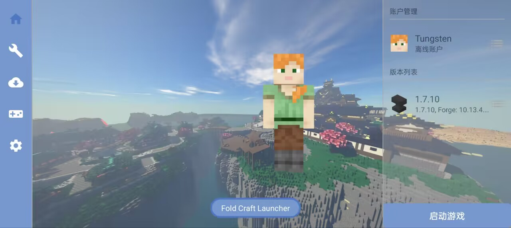
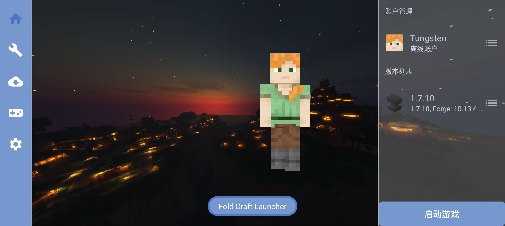
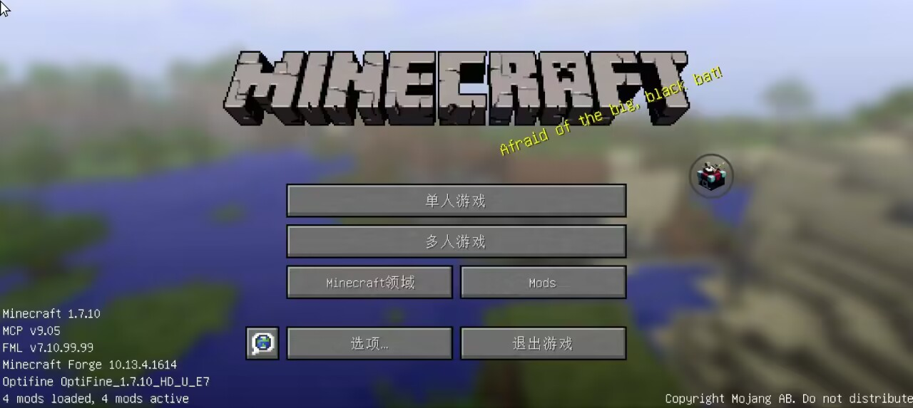

    </img>

<h1 align="center">Fold Craft Launcher</h1>

🌍 **语言**  
简体中文 | [English](./README_EN.md) | [Русский язык](./README_RU.md)

> 你说得对，但是[「FoldCraft Launcher」](https://github.com/FCL-Team/FoldCraftLauncher)是由[FCL-Team](https://github.com/FCL-Team)基于[HMCL](https://github.com/HMCL-dev/HMCL)的核心功能，使用[PojavLauncher](https://github.com/PojavLauncherTeam/PojavLauncher)后端开发的[Minecraft](https://www.minecraft.net/) [Java](https://baike.baidu.com/item/Java%E5%B9%B3%E5%8F%B0/3793459)版启动器。启动器运行在一个被称作[「安卓」](https://baike.baidu.com/item/android/60243)的系统，在这里，被系统选中的人将被授予「JVM」，导引[Java](https://baike.baidu.com/item/Java%E5%B9%B3%E5%8F%B0/3793459)之力。你将扮演一位名为「小白」的神秘用户，在自由的使用中安装不同版本、各有千秋独特的[模组](https://baike.baidu.com/item/%E6%A8%A1%E7%BB%84/58377440)，和它们一起运行，找出崩溃闪退的原因，同时逐步发掘「xxException:」的真相。

> ✨ **项目简介**  
> 「Fold Craft Launcher」是由FCL团队开发的Android平台Minecraft: Java Edition启动器。基于[HMCL](https://github.com/HMCL-dev/HMCL)的核心功能，使用[Amethyst-Android](https://github.com/AngelAuraMC/Amethyst-Android)后端，让您能在移动设备上畅玩Java版MC，支持模组加载与全版本运行。

---

## 🚀 核心特性

✅ **全版本支持**  
- 原生支持 Minecraft 全版本（包括最新快照）
- 模组加载器支持：Forge/NeoForge/LiteLoader/OptiFine/Fabric/Quilt/Cleanroom...

⚙️ **功能亮点**  
- 内置多版本 Java 运行时（Java 8/17/21/25）同时支持导入Java
- 虚拟鼠标与自定义按键映射
- 支持 FCL/ZalithLauncher2 控制布局互转，导入 ZL2 布局自动转换
- 光影支持（需VirGL/Zink/MG渲染器）
- 动态资源管理（模组/整合包/材质/光影/存档）
- 个性化主题定制（背景/颜色方案）
- 支持[渲染器插件化](https://github.com/ShirosakiMio/FCLRendererPlugin)

---

## 🎮 使用截图

  
  
  

---

## 📜 开源协议

本项目采用 **[GPL-3.0 License](https://www.gnu.org/licenses/gpl-3.0.html)** 授权

---

## 🌍 翻译

欢迎参与翻译！本项目通过 [Weblate](https://hosted.weblate.org/projects/foldcraftlauncher/) 管理本地化，无需安装任何工具，直接在网页上贡献翻译即可。

---

## 🤝 贡献与致谢
### 贡献者墙

### 相关项目
- [HMCL](https://github.com/HMCL-dev/HMCL)：核心功能来源（fclcore 移植自 `org.jackhuang.hmcl`）
- [Boat 及其相关项目](https://github.com/AOF-Dev/Boat)
- [Amethyst-Android](https://github.com/AngelAuraMC/Amethyst-Android)（PojavLauncher Android fork）：JVM 启动与渲染后端
- [authlib-injector](https://github.com/yushijinhun/authlib-injector)
- [EasyTier](https://github.com/EasyTier/EasyTier)：局域网联机组网底层
- [Terracotta](https://github.com/burningtnt/Terracotta)：基于 EasyTier 的联机方案（Terracotta 模块 JNI 封装）
- [TouchController](https://github.com/TouchController/TouchController)：触摸控制器依赖
- [NG-GL4ES](https://github.com/ShirosakiMio/NG-GL4ES)：gl4es fork 渲染器
- [FCLRendererPlugin](https://github.com/ShirosakiMio/FCLRendererPlugin)：渲染器插件扩展
- [FCLDriverPlugin](https://github.com/FCL-Team/FCLDriverPlugin)：驱动（Turnip 等）插件扩展

### 依赖

本启动器使用了以下开源库：

| 库 | 版权 | 许可证 | 官方链接 |
|---|---|---|---|
| Amethyst-Android（PojavLauncher Android fork） | AngelAuraMC | GPL-3.0 | https://github.com/AngelAuraMC/Amethyst-Android |
| AndroidX（appcompat / constraintlayout / core-ktx / core-splashscreen / datastore / lifecycle / material / palette / recyclerview / viewpager2 / room） | The Android Open Source Project | Apache-2.0 | https://developer.android.com/jetpack |
| ANGLE | The ANGLE Project Authors | BSD-3-Clause | https://chromium.googlesource.com/angle/angle |
| Apache Commons（IO / Compress） | The Apache Software Foundation | Apache-2.0 | https://commons.apache.org/ |
| bhook（ByteHook，exit code 捕获） | ByteDance | MIT | https://github.com/bytedance/bhook |
| Caciocavallo / cacio-tta（AWT 支持） | FCL-Team | GPL-2.0 + Classpath Exception | https://github.com/FCL-Team/caciocavallo17 |
| chardet（编码探测） | Glavo | MPL-1.1 / GPL-3.0 / LGPL-3.0 | https://github.com/Glavo/java-chardet |
| constant-pool-scanner | Jenkins 社区 | CDDL-1.0 / GPL-2.0 | https://github.com/jenkinsci/constant-pool-scanner |
| control-converter（FCL↔ZL2 控制布局转换语义基准） | NingZeStudio | MIT | https://github.com/anylyralabs/control-converter |
| discord-rpc | Discord Inc. | MIT | https://github.com/discord/discord-rpc |
| EasyTier（Terracotta 内嵌组网底层） | EasyTier Authors | LGPL-3.0 | https://github.com/EasyTier/EasyTier |
| Gamepad Remapper | Mathias-Boulay | LGPL-3.0 | https://github.com/Mathias-Boulay/android_gamepad_remapper |
| Glide | Google Inc. | Apache-2.0 | https://github.com/bumptech/glide |
| Gson | Google Inc. | Apache-2.0 | https://github.com/google/gson |
| jelf | fornwall | MIT | https://github.com/fornwall/jelf |
| JNA（Java Native Access） | JNA contributors | Apache-2.0 / LGPL-2.1 | https://github.com/java-native-access/jna |
| jsoup | Jonathan Hedley | MIT | https://github.com/jhy/jsoup |
| junrar | junrar contributors | UnRAR freeware license | https://github.com/junrar/junrar |
| Kotlin（kotlin-stdlib / kotlinx-coroutines / kotlinx-serialization） | JetBrains s.r.o. | Apache-2.0 | https://github.com/JetBrains/kotlin |
| LWJGL 3（官方 jar + Android 源码补丁） | Lightweight Java Game Library Project | BSD-3-Clause | https://github.com/LWJGL/lwjgl3 |
| lz4-java | Glavo | Apache-2.0 | https://github.com/Glavo/lz4-java |
| Mesa 3D（OSMesa / Kopper-Zink） | The Mesa Authors | MIT | https://gitlab.freedesktop.org/mesa/mesa |
| MobileGlues | MobileGL-Dev | LGPL-2.1 | https://github.com/MobileGL-Dev/MobileGlues |
| NanoHTTPD | NanoHTTPD contributors | BSD-3-Clause | https://github.com/nanohttpd/nanohttpd |
| NG-GL4ES（gl4es fork 渲染器） | BZLZHH / ShirosakiMio | MIT | https://github.com/ShirosakiMio/NG-GL4ES |
| oboe | Google Inc. | Apache-2.0 | https://github.com/google/oboe |
| OpenAL Soft | Chris Robinson | LGPL-2.1 | https://github.com/kcat/openal-soft |
| OpenJDK（多架构运行时，FCL-Team 自建发布） | Oracle / OpenJDK contributors | GPL-2.0 + Classpath Exception | https://github.com/FCL-Team/Android-OpenJDK-Build |
| OpenNBT | Steveice10（GeyserMC） | MIT | https://github.com/GeyserMC/OpenNBT |
| pffft（OpenAL Soft 内嵌） | Julien Pommier | 保留所有权利（ARR） | https://bitbucket.org/jpommier/pffft/src/master/ |
| SDL3 / SDL2 | Sam Lantinga | Zlib | https://github.com/libsdl-org/SDL |
| SimpleFPEWrapper | MobileGL-Dev | LGPL-3.0 | https://github.com/MobileGL-Dev/SimpleFPEWrapper |
| SPIRV-Cross（SPIR-V 反射/转换，natives aar） | Khronos Group | Apache-2.0 | https://github.com/KhronosGroup/SPIRV-Cross |
| Terracotta（联机模块 JNI 封装） | burningtnt | AGPL-3.0 | https://github.com/burningtnt/Terracotta |
| TouchController（触摸控制器 proxy-client-android） | fifthlight | LGPL-3.0 | https://github.com/TouchController/TouchController |
| tomlj | tomlj contributors | Apache-2.0 | https://github.com/tomlj/tomlj |
| virglrenderer | The Virgl Project | MIT | https://gitlab.freedesktop.org/virgl/virglrenderer |
| XZ for Java | Lasse Collin | 0BSD | https://tukaani.org/xz/java.html |
| ZipFileSystem（OpenJDK zipfs 移植模块） | OpenJDK contributors | GPL-2.0 + Classpath Exception | https://github.com/openjdk/jdk |
