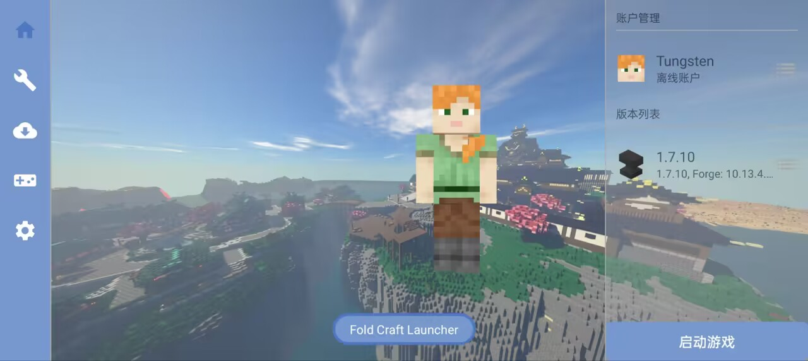
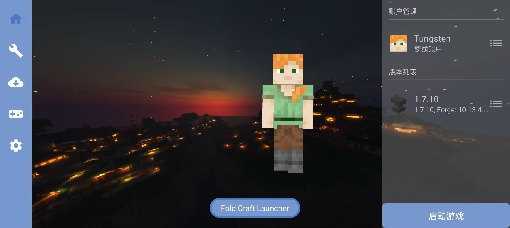
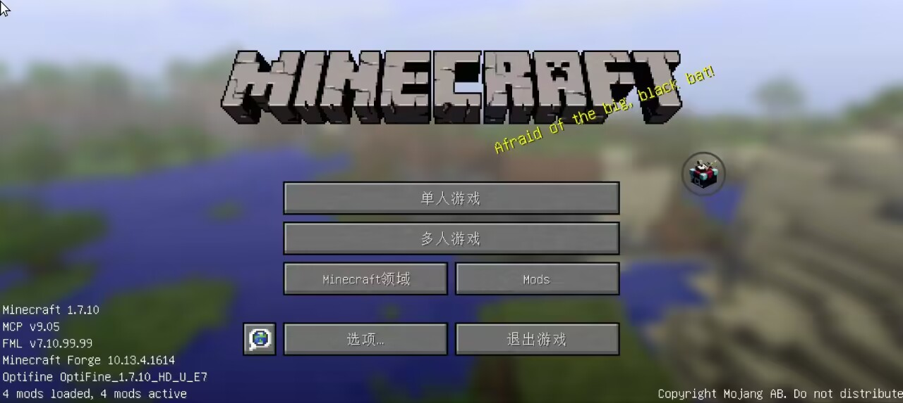

    </img>

<h1 align="center">Fold Craft Launcher</h1>

🌍 **Language**  
[简体中文](./README.md) | English | [Русский язык](./README_RU.md)

> ✨ **Project Introduction**  
> 「Fold Craft Launcher」 is a Minecraft: Java Edition launcher for Android platforms developed by the FCL Team. Built upon the core functionalities of [HMCL](https://github.com/HMCL-dev/HMCL) and using the [Amethyst-Android](https://github.com/AngelAuraMC/Amethyst-Android) backend, it enables users to enjoy Java Edition MC on mobile devices, supporting mod loading and operation across all versions.

---

## 🚀 Core Features

✅ **Full Version Support**  
- Native support for all Minecraft versions (including latest snapshots)
- Mod loader support: Forge/NeoForge/LiteLoader/OptiFine/Fabric/Quilt/Cleanroom...

⚙️ **Key Highlights**  
- Built-in multi-version Java runtimes (Java 8/17/21/25) with custom Java import support
- Virtual mouse and customizable key mapping
- FCL↔ZalithLauncher2 control layout conversion, importing a ZL2 layout converts it automatically
- Shaders support (requires VirGL/Zink/MG renderers)
- Dynamic resource management (mods/modpacks/textures/shaders/saves)
- Personalized theme customization (background/color schemes)
- Supports [renderer pluginization](https://github.com/ShirosakiMio/FCLRendererPlugin)

---

## 🎮 Screenshots

  
  
  

---

## 📜 License

This project is licensed under **[GPL-3.0 License](https://www.gnu.org/licenses/gpl-3.0.html)**

---

## 🌍 Translation

We'd love your help with translations! The project's localization is managed on [Weblate](https://hosted.weblate.org/projects/foldcraftlauncher/) — no tools needed, just translate in your browser.

---

## 🤝 Contributions & Acknowledgements
### Contributors Wall

### Related Projects
- [HMCL](https://github.com/HMCL-dev/HMCL): source of core functionality (fclcore ported from `org.jackhuang.hmcl`)
- [Boat and related projects](https://github.com/AOF-Dev/Boat)
- [Amethyst-Android](https://github.com/AngelAuraMC/Amethyst-Android) (PojavLauncher's Android fork): JVM launching and rendering backend
- [authlib-injector](https://github.com/yushijinhun/authlib-injector)
- [EasyTier](https://github.com/EasyTier/EasyTier): underlying mesh networking for LAN play
- [Terracotta](https://github.com/burningtnt/Terracotta): LAN play solution based on EasyTier (Terracotta module JNI wrapper)
- [TouchController](https://github.com/TouchController/TouchController): touch controller dependency
- [NG-GL4ES](https://github.com/ShirosakiMio/NG-GL4ES): gl4es fork renderer
- [FCLRendererPlugin](https://github.com/ShirosakiMio/FCLRendererPlugin): renderer plugin extension
- [FCLDriverPlugin](https://github.com/FCL-Team/FCLDriverPlugin): driver (Turnip etc.) plugin extension

### Dependencies

This launcher uses the following open source libraries:

| Library | Copyright | License | Official Link |
|---|---|---|---|
| Amethyst-Android (Android fork of PojavLauncher) | AngelAuraMC | GPL-3.0 | https://github.com/AngelAuraMC/Amethyst-Android |
| AndroidX (appcompat / constraintlayout / core-ktx / core-splashscreen / datastore / lifecycle / material / palette / recyclerview / viewpager2 / room) | The Android Open Source Project | Apache-2.0 | https://developer.android.com/jetpack |
| ANGLE | The ANGLE Project Authors | BSD-3-Clause | https://chromium.googlesource.com/angle/angle |
| Apache Commons (IO / Compress) | The Apache Software Foundation | Apache-2.0 | https://commons.apache.org/ |
| bhook (ByteHook, exit code trapping) | ByteDance | MIT | https://github.com/bytedance/bhook |
| Caciocavallo / cacio-tta (AWT support) | FCL-Team | GPL-2.0 + Classpath Exception | https://github.com/FCL-Team/caciocavallo17 |
| chardet (charset detection) | Glavo | MPL-1.1 / GPL-3.0 / LGPL-3.0 | https://github.com/Glavo/java-chardet |
| constant-pool-scanner | Jenkins community | CDDL-1.0 / GPL-2.0 | https://github.com/jenkinsci/constant-pool-scanner |
| control-converter (semantics baseline of the FCL↔ZL2 control layout converter) | NingZeStudio | MIT | https://github.com/anylyralabs/control-converter |
| discord-rpc | Discord Inc. | MIT | https://github.com/discord/discord-rpc |
| EasyTier (networking layer embedded in Terracotta) | EasyTier Authors | LGPL-3.0 | https://github.com/EasyTier/EasyTier |
| Gamepad Remapper | Mathias-Boulay | LGPL-3.0 | https://github.com/Mathias-Boulay/android_gamepad_remapper |
| Glide | Google Inc. | Apache-2.0 | https://github.com/bumptech/glide |
| Gson | Google Inc. | Apache-2.0 | https://github.com/google/gson |
| jelf | fornwall | MIT | https://github.com/fornwall/jelf |
| JNA (Java Native Access) | JNA contributors | Apache-2.0 / LGPL-2.1 | https://github.com/java-native-access/jna |
| jsoup | Jonathan Hedley | MIT | https://github.com/jhy/jsoup |
| junrar | junrar contributors | UnRAR freeware license | https://github.com/junrar/junrar |
| Kotlin (kotlin-stdlib / kotlinx-coroutines / kotlinx-serialization) | JetBrains s.r.o. | Apache-2.0 | https://github.com/JetBrains/kotlin |
| LWJGL 3 (official jars + Android source patches) | Lightweight Java Game Library Project | BSD-3-Clause | https://github.com/LWJGL/lwjgl3 |
| lz4-java | Glavo | Apache-2.0 | https://github.com/Glavo/lz4-java |
| Mesa 3D (OSMesa / Kopper-Zink) | The Mesa Authors | MIT | https://gitlab.freedesktop.org/mesa/mesa |
| MobileGlues | MobileGL-Dev | LGPL-2.1 | https://github.com/MobileGL-Dev/MobileGlues |
| NanoHTTPD | NanoHTTPD contributors | BSD-3-Clause | https://github.com/nanohttpd/nanohttpd |
| NG-GL4ES (gl4es fork renderer) | BZLZHH / ShirosakiMio | MIT | https://github.com/ShirosakiMio/NG-GL4ES |
| oboe | Google Inc. | Apache-2.0 | https://github.com/google/oboe |
| OpenAL Soft | Chris Robinson | LGPL-2.1 | https://github.com/kcat/openal-soft |
| OpenJDK (multi-arch runtimes, built and released by FCL-Team) | Oracle / OpenJDK contributors | GPL-2.0 + Classpath Exception | https://github.com/FCL-Team/Android-OpenJDK-Build |
| OpenNBT | Steveice10 (GeyserMC) | MIT | https://github.com/GeyserMC/OpenNBT |
| pffft (embedded in OpenAL Soft) | Julien Pommier | All rights reserved (ARR) | https://bitbucket.org/jpommier/pffft/src/master/ |
| SDL3 / SDL2 | Sam Lantinga | Zlib | https://github.com/libsdl-org/SDL |
| SimpleFPEWrapper | MobileGL-Dev | LGPL-3.0 | https://github.com/MobileGL-Dev/SimpleFPEWrapper |
| SPIRV-Cross (SPIR-V reflection/translation, natives aar) | Khronos Group | Apache-2.0 | https://github.com/KhronosGroup/SPIRV-Cross |
| Terracotta (JNI wrapper of the multiplayer module) | burningtnt | AGPL-3.0 | https://github.com/burningtnt/Terracotta |
| TouchController (touch controller proxy-client-android) | fifthlight | LGPL-3.0 | https://github.com/TouchController/TouchController |
| tomlj | tomlj contributors | Apache-2.0 | https://github.com/tomlj/tomlj |
| virglrenderer | The Virgl Project | MIT | https://gitlab.freedesktop.org/virgl/virglrenderer |
| XZ for Java | Lasse Collin | 0BSD | https://tukaani.org/xz/java.html |
| ZipFileSystem (port of OpenJDK zipfs) | OpenJDK contributors | GPL-2.0 + Classpath Exception | https://github.com/openjdk/jdk |
