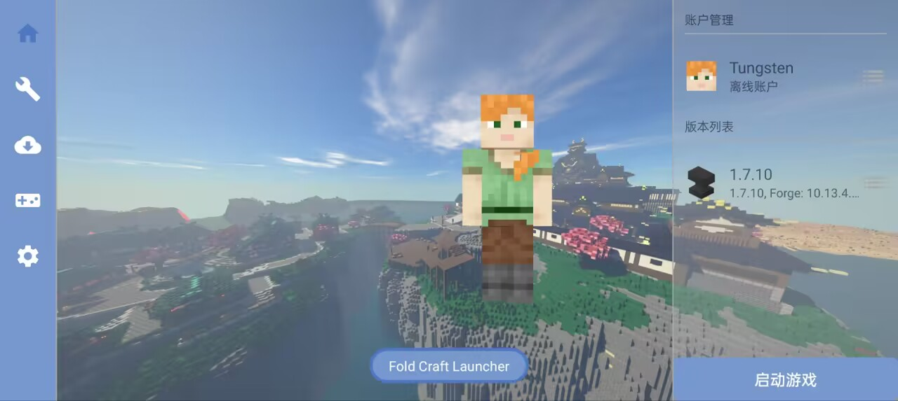
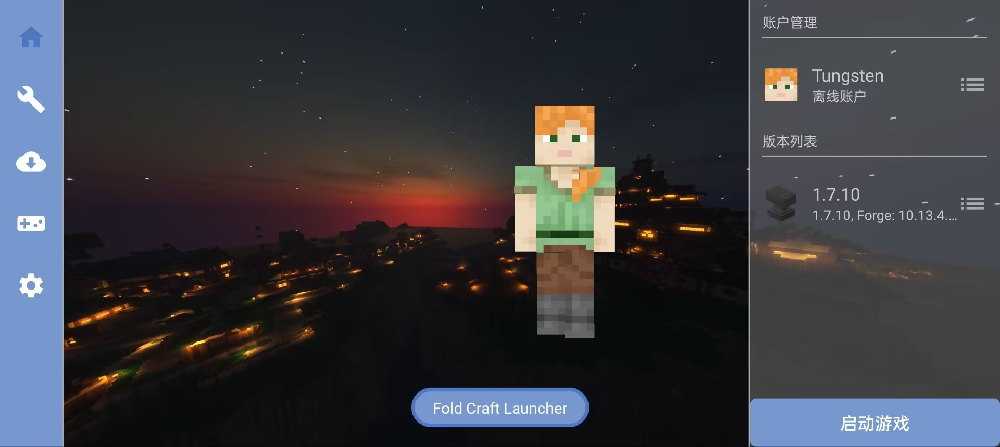
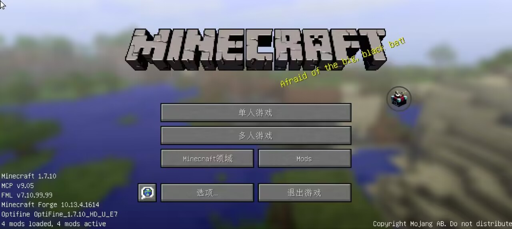

    </img>

<h1 align="center">Fold Craft Launcher</h1>

🌍 **Язык**
[简体中文](./README.md) | [English](./README_EN.md) | Русский

> 「Fold Craft Launcher」 — это лаунчер Minecraft: Java Edition для платформы Android, разрабатываемый командой FCL Team. Созданный на базе ключевых функций [HMCL](https://github.com/HMCL-dev/HMCL) и с интеграцией бэкенда [PojavLauncher](https://github.com/PojavLauncherTeam/PojavLauncher), он позволяет запускать Minecraft: Java Edition на мобильных устройствах, поддерживая загрузку и работу модов для всех версий игры.

---

## 🚀 Основные возможности

✅ **Поддержка всех версий**  
- Встроенная поддержка всех версий Minecraft (включая последние снапшоты)
- Поддержка загрузчиков модов: Forge/NeoForge/LiteLoader/OptiFine/Fabric/Quilt/Cleanroom...

⚙️ **Основные преимущества**  
- Встроенные среды выполнения Java разных версий (Java 8/17/21/25) с возможностью импорта пользовательских версий Java
- Виртуальная мышь и переназначение клавиш
- Конвертация раскладок управления между FCL и ZalithLauncher2, импорт раскладок ZL2 с автоматическим преобразованием
- Поддержка шейдеров (требуются рендереры VirGL/Zink/MG)
- Гибкое управление ресурсами (моды/модпаки/текстуры/шейдеры/сохранения)
- Настройка тем оформления (фон/цветовые схемы)
- Поддержка [плагинов рендеринга](https://github.com/ShirosakiMio/FCLRendererPlugin)

---

## 🎮 Скриншоты

  
  
  

---

## 📜 Лицензия

Данный проект распространяется под **[лицензией GPL-3.0](https://www.gnu.org/licenses/gpl-3.0.html)**

---

## 🌍 Перевод

Присоединяйтесь к переводу проекта! Локализация управляется через [Weblate](https://hosted.weblate.org/projects/foldcraftlauncher/) — никаких инструментов не требуется, просто переводите в браузере.

---

## 🤝 Участие и благодарности
### Стена участников

### Связанные проекты
- [HMCL](https://github.com/HMCL-dev/HMCL)
- [Boat и связанные проекты](https://github.com/AOF-Dev/Boat)
- [PojavLauncher и связанные проекты](https://github.com/PojavLauncherTeam/PojavLauncher)
- [authlib-injector](https://github.com/yushijinhun/authlib-injector)

### Сторонние компоненты

В лаунчере используются следующие библиотеки с открытым исходным кодом:

| Библиотека | Правообладатель | Лицензия | Официальная ссылка |
|---|---|---|---|
| Amethyst-Android (Android-форк PojavLauncher) | AngelAuraMC | GPL-3.0 | https://github.com/AngelAuraMC/Amethyst-Android |
| AndroidX (appcompat / constraintlayout / core-ktx / core-splashscreen / datastore / lifecycle / material / palette / recyclerview / viewpager2 / room) | The Android Open Source Project | Apache-2.0 | https://developer.android.com/jetpack |
| ANGLE | The ANGLE Project Authors | BSD-3-Clause | https://chromium.googlesource.com/angle/angle |
| Apache Commons (IO / Compress) | The Apache Software Foundation | Apache-2.0 | https://commons.apache.org/ |
| bhook (ByteHook, перехват кодов выхода) | ByteDance | MIT | https://github.com/bytedance/bhook |
| Caciocavallo / cacio-tta (поддержка AWT) | FCL-Team | GPL-2.0 + Classpath Exception | https://github.com/FCL-Team/caciocavallo17 |
| chardet (определение кодировки) | Glavo | MPL-1.1 / GPL-3.0 / LGPL-3.0 | https://github.com/Glavo/java-chardet |
| constant-pool-scanner | Сообщество Jenkins | CDDL-1.0 / GPL-2.0 | https://github.com/jenkinsci/constant-pool-scanner |
| control-converter (семантическая основа конвертера раскладок управления FCL↔ZL2) | NingZeStudio | MIT | https://github.com/anylyralabs/control-converter |
| discord-rpc | Discord Inc. | MIT | https://github.com/discord/discord-rpc |
| EasyTier (сетевой слой, встроенный в Terracotta) | EasyTier Authors | LGPL-3.0 | https://github.com/EasyTier/EasyTier |
| Gamepad Remapper | Mathias-Boulay | LGPL-3.0 | https://github.com/Mathias-Boulay/android_gamepad_remapper |
| Glide | Google Inc. | Apache-2.0 | https://github.com/bumptech/glide |
| Gson | Google Inc. | Apache-2.0 | https://github.com/google/gson |
| jelf | fornwall | MIT | https://github.com/fornwall/jelf |
| JNA (Java Native Access) | JNA contributors | Apache-2.0 / LGPL-2.1 | https://github.com/java-native-access/jna |
| jsoup | Jonathan Hedley | MIT | https://github.com/jhy/jsoup |
| junrar | junrar contributors | UnRAR freeware license | https://github.com/junrar/junrar |
| Kotlin (kotlin-stdlib / kotlinx-coroutines / kotlinx-serialization) | JetBrains s.r.o. | Apache-2.0 | https://github.com/JetBrains/kotlin |
| LWJGL 3 (официальные jar + патчи исходников для Android) | Lightweight Java Game Library Project | BSD-3-Clause | https://github.com/LWJGL/lwjgl3 |
| lz4-java | Glavo | Apache-2.0 | https://github.com/Glavo/lz4-java |
| Mesa 3D (OSMesa / Kopper-Zink) | The Mesa Authors | MIT | https://gitlab.freedesktop.org/mesa/mesa |
| MobileGlues | MobileGL-Dev | LGPL-2.1 | https://github.com/MobileGL-Dev/MobileGlues |
| NanoHTTPD | NanoHTTPD contributors | BSD-3-Clause | https://github.com/nanohttpd/nanohttpd |
| NG-GL4ES (рендерер — форк gl4es) | BZLZHH / ShirosakiMio | MIT | https://github.com/ShirosakiMio/NG-GL4ES |
| oboe | Google Inc. | Apache-2.0 | https://github.com/google/oboe |
| OpenAL Soft | Chris Robinson | LGPL-2.1 | https://github.com/kcat/openal-soft |
| OpenJDK (мультиархитектурные среды выполнения, собираются и публикуются FCL-Team) | Oracle / OpenJDK contributors | GPL-2.0 + Classpath Exception | https://github.com/FCL-Team/Android-OpenJDK-Build |
| OpenNBT | Steveice10 (GeyserMC) | MIT | https://github.com/GeyserMC/OpenNBT |
| pffft (встроен в OpenAL Soft) | Julien Pommier | все права защищены (ARR) | https://bitbucket.org/jpommier/pffft/src/master/ |
| SDL3 / SDL2 | Sam Lantinga | Zlib | https://github.com/libsdl-org/SDL |
| SimpleFPEWrapper | MobileGL-Dev | LGPL-3.0 | https://github.com/MobileGL-Dev/SimpleFPEWrapper |
| SPIRV-Cross (рефлексия/трансляция SPIR-V, natives aar) | Khronos Group | Apache-2.0 | https://github.com/KhronosGroup/SPIRV-Cross |
| Terracotta (JNI-обёртка модуля многопользовательской игры) | burningtnt | AGPL-3.0 | https://github.com/burningtnt/Terracotta |
| TouchController (сенсорный контроллер proxy-client-android) | fifthlight | LGPL-3.0 | https://github.com/TouchController/TouchController |
| tomlj | tomlj contributors | Apache-2.0 | https://github.com/tomlj/tomlj |
| virglrenderer | The Virgl Project | MIT | https://gitlab.freedesktop.org/virgl/virglrenderer |
| XZ for Java | Lasse Collin | 0BSD | https://tukaani.org/xz/java.html |
| ZipFileSystem (порт OpenJDK zipfs) | OpenJDK contributors | GPL-2.0 + Classpath Exception | https://github.com/openjdk/jdk |